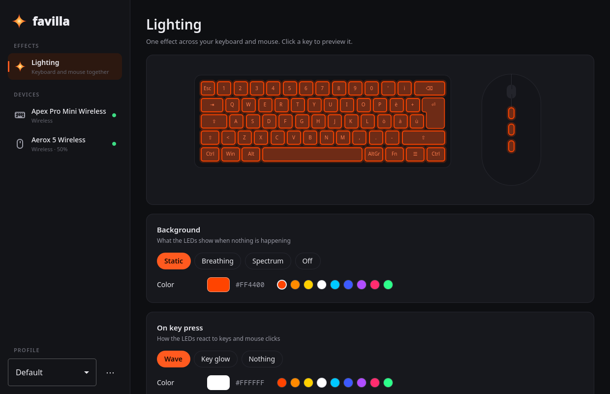

<p align="center">
  
</p>

<h1 align="center">Favilla</h1>

<p align="center">
  Lighting and settings for SteelSeries keyboards and mice, made for Linux.<br>
  An open source alternative to SteelSeries GG.
</p>

<p align="center">
  <a href="https://github.com/fontanamichele/favilla/actions/workflows/tests.yml"></a>
</p>



> **Early days.** Favilla is a young project: it works well on the devices
> listed below, and everything else is on the roadmap.

## Features

- **One effect across your desk.** Keyboard and mouse share a single lighting
  effect: static, breathing or spectrum background, plus a reaction to key
  presses and clicks. A wave started on the keyboard travels to the mouse,
  and a click sends it back across the keyboard.
- **Live preview.** The app draws your keyboard and mouse with the colors they
  are showing right now. Click a key to preview the effect.
- **Mouse settings.** DPI presets, polling rate, sleep and dim timers and the
  click flash, saved to the mouse memory.
- **Profiles** for switching between setups.
- **Small and transparent.** A user service (`favillad`) talks to the devices
  and exposes a D-Bus API; the app (`favilla`) and the command line tool
  (`favillactl`) are just clients. No root, no kernel modules, no telemetry.

## Supported devices

| Device | Connection | Lighting | Settings | Status |
|---|---|---|---|---|
| Apex Pro Mini Wireless | 2.4 GHz dongle | per key | on the roadmap | tested |
| Apex Pro Mini Wireless | USB cable | per key | on the roadmap | untested |
| Apex Pro Mini | USB | per key | on the roadmap | untested |
| Aerox 5 Wireless | 2.4 GHz dongle | 3 zones | DPI, polling rate, timers, click flash | tested |
| Other mice supported by [rivalcfg] | USB / 2.4 GHz | zones | what rivalcfg supports | untested |

Own a SteelSeries device that is missing or untested? See
[Contributing](#contributing).

## Install

Favilla needs Python 3.11+, PyGObject, PySide6 (Qt 6.5+) and [rivalcfg].
On Fedora and Nobara:

```bash
sudo dnf install python3-gobject python3-pyside6
pip install --user rivalcfg
```

Then:

```bash
git clone https://github.com/fontanamichele/favilla.git
cd favilla
./install.sh
```

This installs the commands in `~/.local/bin`, starts the `favilla` user service
(it starts again at every login) and adds Favilla to the application menu.
SteelSeries devices also need a udev rule so that your user can use them
without root; the installer prints the two commands to run once.

`./install.sh --uninstall` removes everything except your configuration.

## Usage

Open **Favilla** from the application menu. Or use the terminal:

```bash
favillactl status                  # devices, battery, active profile
favillactl color '#ff4400'         # background color
favillactl effect breathing        # static, breathing, spectrum, off
favillactl reactive ripple --color '#ffffff'
favillactl use Gaming              # switch profile
```

The configuration lives in `~/.config/favilla/config.json` and the service log
is available with `journalctl --user -u favilla`.

## How it works

`favillad` finds SteelSeries devices through `/sys/class/hidraw`, opens their
HID interfaces directly and runs a 60 fps lighting engine. Every device is
placed in a shared desk space measured in keys, which is how one effect spans
several devices. Mouse support reuses the device descriptions of [rivalcfg],
while the packets are sent by Favilla itself so that animation frames and
settings never collide.

More in [docs/architecture.md](docs/architecture.md) and in the
[protocol notes](docs/protocols).

## Roadmap

- Apex Pro Mini: actuation point, Rapid Trigger, key remapping and Fn layer.
  These need USB captures of SteelSeries GG: see
  [docs/reverse-engineering.md](docs/reverse-engineering.md).
- Mouse button remapping.
- Software macros and remapping for any device (uinput).
- Automatic profile per application on KDE Plasma.
- Italian translation, then more languages.
- Packages: RPM, AUR, Flatpak.

## Contributing

- **Report your device.** Run `favillactl status` and open an issue with the
  output, the model and whether lighting works.
- **Add a device.** [docs/adding-a-device.md](docs/adding-a-device.md) explains
  the driver interface and how to capture the protocol.
- **Run the tests** before sending changes. They also run on GitHub for every
  push and pull request.

  ```bash
  PYTHONPATH=src python3 -m unittest discover -s tests
  ```

## Credits

- [rivalcfg] by Fabien Loison: mouse protocols and device descriptions.
- The [SignalRGB plugins](https://gitlab.com/signalrgb/signal-plugins): the
  reference for the Apex Pro Mini lighting protocol.
- [OpenRGB](https://openrgb.org), for showing how far open hardware support can go.

## License

Favilla is free software, released under the
[GNU General Public License v3.0 or later](LICENSE).

Favilla is not affiliated with or endorsed by SteelSeries. SteelSeries, Apex,
Aerox and GG are trademarks of SteelSeries ApS.

[rivalcfg]: https://github.com/flozz/rivalcfg
